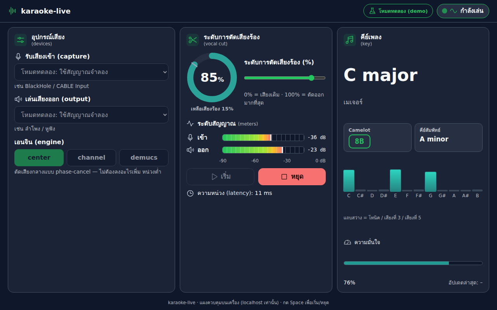
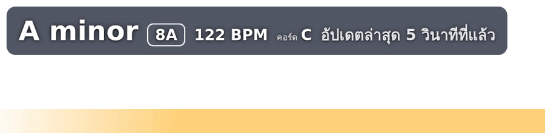
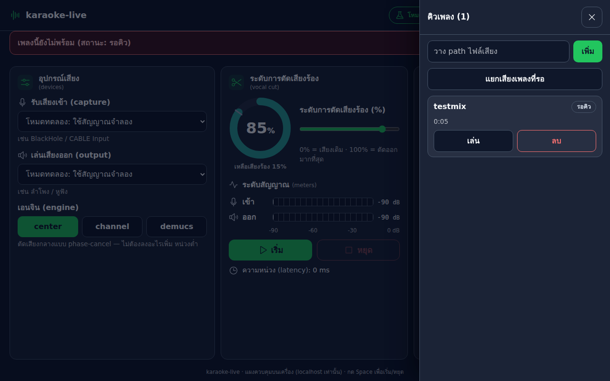
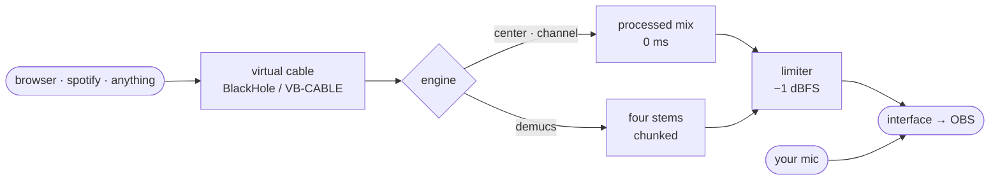

<p align="center">
  
</p>

<h1 align="center">karaoke-live</h1>

<p align="center">
  <b>Drop the singer, keep the band — on anything your computer plays.</b><br>
  <sub>Live vocal removal, song key, tempo, chords, and a setlist that renders itself.</sub>
</p>

<p align="center">
  <a href="https://github.com/noonutz/karaoke-live/actions/workflows/tests.yml"></a>
  
  
  
  
</p>

---

Most vocal removers are built for the opposite job: they isolate *speech* and throw the music
away. karaoke-live keeps the music and throws the singer away — then tells you what key the
song is in, so you know whether you can actually sing it.

```bash
karaokelive live --capture "BlackHole 2ch" --output "Speakers" --vocal-level 85
```

One process between your system audio and your speakers. One knob.

## Three engines, one interface

| engine | what it does | latency | needs |
|:--|:--|:--|:--|
| **center** *(default)* | Phase-cancels the centre image with a 4th-order crossover and a level-compensated blend. Bass survives, backing survives. | **0 ms** | numpy + ffmpeg |
| **channel** | Takes one channel. For multiplex sources where the guide vocal is hard on one side. | **0 ms** | numpy + ffmpeg |
| **demucs** | Real ML separation, chunked with overlap-add so it runs while you sing. | ~2.5 s | + torch, demucs |

`center` is the one that always works: no model, no GPU, no added latency — the same trick
karaoke amplifiers have used since the 90s, with a crossover steep enough that the vocal does
not leak back in. `demucs` sounds better (keeps stereo, keeps the drums, no anti-phase ghost)
and pays for it with one chunk of latency, because a non-causal model cannot output anything
until it has heard the samples after it.

## It also knows the song

<p align="center">
  
</p>

Add `http://127.0.0.1:8765/overlay` as an OBS Browser Source and the stream shows the key, the
Camelot code, the BPM and the current chord on a translucent pill that stays readable over a
bright camera image. `?scale=1.6` enlarges it, `?simple=1` keeps only the key.

`karaokelive key song.mp3` does the same offline. Once you have recorded your comfortable
range, it also tells you whether the song fits:

```
เพลงนี้อยู่ key: A minor   (Camelot 8A)
ความมั่นใจ: 75%
ช่วงเสียงเพลง: A3-E4 (กว้าง 7.0 semitone) — ร้องได้สบาย
```

## A setlist that renders itself

Live ML separation is expensive, so give it time instead of CPU: queue the songs before the
stream, let the worker separate them in the background while you sing the current one, then
play the ready stems with zero separation latency.

<p align="center">
  
</p>

A song rendered to four stems also gets three controls that are useful while *singing*, rather
than a DJ deck you have to babysit:

- **ตัดกลอง** — drop the drums for the build, bring them back on the chorus.
- **วน 4 ห้อง** — loop four bars, snapped to the bar grid from the tempo measured at render time.
- **เสียงร้อง** — 0 is karaoke, 50 is a backing vocal to sing harmony with, 100 is the original.

`Esc`, or the red **เงียบ** button, is the panic key: one press stops everything, and the panel
can start again immediately.

## How the audio flows



The limiter is there because centre-cancel can boost panned content by up to +6 dB and stems
sum — without it a hot track clips in OBS. It is stereo-linked and lookahead-free, so it costs
no latency, and the panel shows `GR −3.2 dB` while it is working.

## Verified, not asserted

| what | result |
|:--|:--|
| Centre removal on a real file | centred tone **−33.8 dB**, panned content moves < 0.1 dB |
| Key detection | **24/24** on synthesised progressions in all twelve major and minor keys |
| Tempo | 85–174 BPM within **1.5 BPM**; white noise scores 0.05 confidence |
| Vocal range | **6/6** melodies exact, 0 misses |
| Stem loop drift | 333-frame blocksize → **0.00 ms** off after 96,237 frames |
| Limiter | +12 dB over full scale comes out at **exactly 1.0**; ten 512-frame blocks are bit-identical to one 5120-frame block |
| Test suite | **104 tests**, no network, no audio device, numpy only |

What is **not** verified yet, because this was built on a headless Linux box: real audio
devices, the demucs weights, and the microphone. [`docs/MAC-TEST.md`](docs/MAC-TEST.md) is the
checklist for the machine that will prove those.

## Install

```bash
git clone https://github.com/noonutz/karaoke-live && cd karaoke-live
python3 -m venv .venv && .venv/bin/pip install -e '.[live]'
brew install ffmpeg portaudio blackhole-2ch          # macOS
```

```bash
karaokelive devices        # what it can hear and speak
karaokelive ui             # control panel at http://127.0.0.1:8765
karaokelive ui --demo      # the same UI on a simulated signal, no device needed
```

Windows uses [VB-CABLE](https://vb-audio.com/Cable/) instead of BlackHole. Routing details,
the mono-collapse trap and the rest of the sharp edges live in
[the full guide](docs/GUIDE.md) — they matter more than the code does.

## Licence

MIT. Standing on [Demucs](https://github.com/facebookresearch/demucs) for the ML engine,
[Poise Voice Isolator](https://github.com/chabandou/poise-voice-isolator) for the shape of the
problem, and [BlackHole](https://github.com/ExistentialAudio/BlackHole) /
[VB-CABLE](https://vb-audio.com/Cable/) for the routing. Demucs' code is MIT but its pretrained
weights are not — this repo never ships weights, `demucs` downloads them.

<p align="center"><sub>English · <a href="README.th.md">ไทย</a></sub></p>
