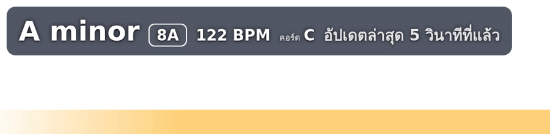
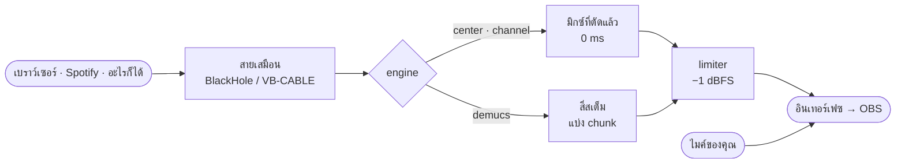

<p align="center">
  
</p>

<h1 align="center">karaoke-live</h1>

<p align="center">
  <b>เก็บวงไว้ ตัดคนร้องออก — ใช้ได้กับทุกเสียงที่เครื่องคุณเล่น</b><br>
  <sub>ตัดเสียงร้องสด ๆ พร้อมบอกคีย์, BPM, คอร์ด และคิวเพลงที่เรนเดอร์ล่วงหน้าเอง</sub>
</p>

<p align="center">
  <a href="https://github.com/noonutz/karaoke-live/actions/workflows/tests.yml"></a>
  
  
  
  
</p>

---

เครื่องมือตัดเสียงร้องส่วนใหญ่ถูกออกแบบมาเพื่องานตรงกันข้าม คือแยก **เสียงพูด** ออกมาแล้วทิ้งดนตรี
ส่วน karaoke-live เก็บดนตรีไว้ ทิ้งคนร้อง แล้วบอกด้วยว่าเพลงนี้อยู่คีย์อะไร คุณจะได้รู้ว่าร้องไหวหรือเปล่า

```bash
karaokelive live --capture "BlackHole 2ch" --output "Speakers" --vocal-level 85
```

โปรเซสเดียว คั่นระหว่างเสียงระบบกับลำโพงคุณ ปุ่มเดียว

## สามเอนจิน ใช้ interface เดียวกัน

| engine | ทำอะไร | latency | ต้องมี |
|:--|:--|:--|:--|
| **center** *(ค่าเริ่มต้น)* | ตัดเสียงกลางภาพด้วยการกลับเฟส ผ่านครอสโอเวอร์อันดับ 4 และชดเชยระดับเสียงให้ เบสอยู่ ดนตรีอยู่ | **0 ms** | numpy + ffmpeg |
| **channel** | เลือกข้างเดียว สำหรับแหล่ง multiplex ที่เสียงร้องอยู่ข้างเดียวชัด ๆ | **0 ms** | numpy + ffmpeg |
| **demucs** | แยกด้วยโมเดลจริง แบ่ง chunk พร้อม overlap-add ให้รันระหว่างร้องได้ | ~2.5 วิ | + torch, demucs |

`center` คือตัวที่ใช้ได้เสมอ: ไม่ต้องโหลดโมเดล ไม่ต้องมี GPU ไม่เพิ่ม latency และเป็นเทคนิคเดียวกับที่
แอมป์คาราโอเกะใช้มาตั้งแต่ยุค 90 — แต่ใช้ครอสโอเวอร์ที่ชันพอจะไม่ให้เสียงร้องรั่วกลับมา
`demucs` เสียงดีกว่า (คง stereo, กลองอยู่ครบ, ไม่มีเสียงเงากลับเฟส) แลกกับ latency หนึ่ง chunk
เพราะโมเดลแบบ non-causal จะปล่อยเสียงออกไม่ได้จนกว่าจะได้ยินเสียงที่อยู่ถัดไปก่อน

## รู้จักเพลงด้วย

<p align="center">
  
</p>

เพิ่ม `http://127.0.0.1:8765/overlay` เป็น OBS Browser Source แล้วสตรีมจะโชว์คีย์, รหัส Camelot, BPM
และคอร์ดปัจจุบัน บนแถบกึ่งโปร่งที่อ่านออกแม้ทับภาพกล้องสว่าง ๆ — `?scale=1.6` ขยาย,
`?simple=1` เหลือแค่คีย์

`karaokelive key song.mp3` ทำงานเดียวกันแบบออฟไลน์ และถ้าคุณบันทึกช่วงเสียงไว้แล้ว มันจะบอกด้วยว่าร้องได้ไหม:

```
เพลงนี้อยู่ key: A minor   (Camelot 8A)
ความมั่นใจ: 75%
ช่วงเสียงเพลง: A3-E4 (กว้าง 7.0 semitone) — ร้องได้สบาย
```

## คิวเพลงที่เรนเดอร์เอง

ML แบบสดกิน latency ก้อนหนึ่ง จึงควรให้เวลามันแทนการเร่ง CPU: ใส่เพลงเข้าคิวก่อนไลฟ์ ปล่อยให้
worker แยกเสียงอยู่เบื้องหลังระหว่างที่คุณร้องเพลงปัจจุบัน แล้วค่อยเล่นสเต็มที่พร้อมแล้ว ซึ่งไม่มี
ความหน่วงจากการแยกเลย

<p align="center">
  
</p>

เพลงที่ถูกแยกเป็น 4 สเต็มจะได้สามคอนโทรลที่ใช้จริงตอน *ร้อง* ไม่ใช่เด็คดีเจที่ต้องคอยดูแล:

- **ตัดกลอง** — ดึงกลองออกตอน build แล้วกลับมาเข้าฮุก
- **วน 4 ห้อง** — วนสี่ห้อง โดยจุดเริ่มถูกปัดให้ตรงกริดห้องจาก BPM ที่วัดไว้ตอนเรนเดอร์
- **เสียงร้อง** — 0 คือคาราโอเกะ, 50 คือเสียงประสานให้ร้องคู่, 100 คือต้นฉบับ

`Esc` หรือปุ่มแดง **เงียบ** คือปุ่ม panic: กดครั้งเดียวหยุดทุกอย่าง แล้วเริ่มใหม่ได้ทันที

## เส้นทางเสียง



ที่ต้องมี limiter เพราะ center-cancel ชดเชยเสียงแพนข้างได้ถึง +6 dB และสเต็มบวกรวมกัน ถ้าไม่มี
เพลงดัง ๆ จะ clip ใน OBS — ตัวนี้เป็น stereo-linked และไม่มี lookahead จึงไม่เพิ่ม latency
และแผงจะขึ้น `GR −3.2 dB` ขณะทำงาน

## ผ่านการวัด ไม่ใช่การกล่าวอ้าง

| วัดอะไร | ผล |
|:--|:--|
| ตัดเสียงกลางบนไฟล์จริง | โทนกลางภาพ **−33.8 dB** ขณะที่เสียงแพนข้างขยับ < 0.1 dB |
| ตรวจจับคีย์ | **24/24** บน progression สังเคราะห์ครบ 12 เมเจอร์และ 12 ไมเนอร์ |
| BPM | 85–174 BPM คลาดไม่เกิน **1.5 BPM**; white noise ได้ confidence 0.05 |
| ช่วงเสียง | **6/6** ทำนอง ตรงทั้งหมด ไม่พลาด |
| ลูปสเต็ม | blocksize 333 เฟรม → คลาด **0.00 ms** หลังเล่น 96,237 เฟรม |
| Limiter | +12 dB เกิน full scale ออกมา **1.0 พอดี**; 10 บล็อก × 512 เท่ากับ 1 บล็อก × 5120 ทุก sample |
| ชุดเทสต์ | **104 ตัว** ไม่ใช้เน็ต ไม่ต้องมีอุปกรณ์เสียง ใช้ numpy อย่างเดียว |

สิ่งที**ยังไม่ได้**ยืนยัน เพราะสร้างบนเครื่อง Linux ที่ไม่มีอุปกรณ์เสียง: อุปกรณ์เสียงจริง,
weights ของ demucs, และไมโครโฟน — [`docs/MAC-TEST.md`](docs/MAC-TEST.md) คือ checklist สำหรับเครื่องที่จะพิสูจน์สิ่งเหล่านั้น

## ติดตั้ง

```bash
git clone https://github.com/noonutz/karaoke-live && cd karaoke-live
python3 -m venv .venv && .venv/bin/pip install -e '.[live]'
brew install ffmpeg portaudio blackhole-2ch          # macOS
```

```bash
karaokelive devices        # มีอะไรให้ฟังและให้พูด
karaokelive ui             # แผงควบคุมที่ http://127.0.0.1:8765
karaokelive ui --demo      # UI เดียวกันบนสัญญาณจำลอง ไม่ต้องมีอุปกรณ์
```

Windows ใช้ [VB-CABLE](https://vb-audio.com/Cable/) แทน BlackHole รายละเอียดการต่อสาย
กับดัก mono-collapse และขอบมีดอื่น ๆ อยู่ใน [คู่มือฉบับเต็ม](docs/GUIDE.md) (ภาษาอังกฤษ)

## สัญญาอนุญาต

MIT ยืนบนไหล่ของ [Demucs](https://github.com/facebookresearch/demucs) (เอนจิน ML),
[Poise Voice Isolator](https://github.com/chabandou/poise-voice-isolator) (รูปร่างของปัญหา),
และ [BlackHole](https://github.com/ExistentialAudio/BlackHole) /
[VB-CABLE](https://vb-audio.com/Cable/) (การต่อสาย) โค้ด Demucs เป็น MIT แต่ weights ที่เทรนมา
ไม่อยู่ใต้สัญญานั้น — repo นี้ไม่เคย commit weights, `demucs` โหลดเองตอนติดตั้ง

<p align="center"><sub><a href="README.md">English</a> · ไทย</sub></p>
