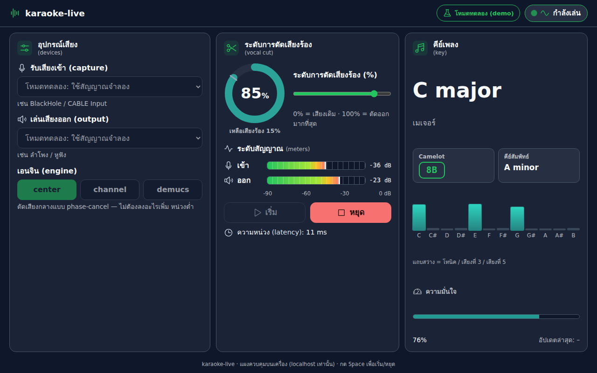

# karaoke-live

[English](README.md) · **ไทย**



ตัดเสียงร้องนำออกจากอะไรก็ตามที่คอมพิวเตอร์กำลังเล่นอยู่ แบบสด ๆ แล้วร้องทับได้
ทำมาสำหรับงานที่เครื่องมือทั่วไปไม่ตอบ: ไม่ใช่ "ฟังเสียงพูดในหนังให้ชัด" แต่เป็น
**"เก็บดนตรีไว้ ตัดคนร้องออก"**

สามเอนจิน ใช้ interface เดียวกัน:

| engine | ทำอะไร | latency | ต้องมีอะไร |
|---|---|---|---|
| `center` (ค่าเริ่มต้น) | ตัดเสียงกลางภาพด้วยการกลับเฟส, คืนเบสให้, ปรับได้ 0-100% | **0** | numpy + ffmpeg |
| `channel` | เลือกข้างเดียว (แหล่ง multiplex: ร้องชัดข้างซ้าย ดนตรีข้างขวา) | **0** | numpy + ffmpeg |
| `demucs` | แยก 2 stem ด้วยโมเดลจริง แบบแบ่ง chunk | **~chunk_s** (ตั้งต้น 2.5 วิ) | + torch, demucs |

`center` คือตัวที่ใช้ได้เสมอ: ไม่ต้องโหลดโมเดล ไม่ต้องมี GPU ไม่เพิ่ม latency
และเป็นเทคนิคเดียวกับที่แอมป์คาราโอเกะใช้มาตั้งแต่ยุค 90 — ต่างกันแค่ใช้ครอสโอเวอร์
อันดับ 4 เพื่อไม่ให้เบสหาย และชดเชยระดับเสียงตอนหมุนปุ่ม เพื่อให้หมุนแรงขึ้นแล้ว
ดนตรีไม่เบาลง

`demucs` เสียงดีกว่า (คง stereo, กลองอยู่ครบ, ไม่มีเสียงร้องเงากลับเฟส)
แลกกับ latency หนึ่ง chunk — เป็นการแลกที่ตรงไปตรงมา: โมเดลแบบ non-causal
จะปล่อยเสียงออกไม่ได้จนกว่าจะได้ยินเสียงที่อยู่ถัดไปก่อน

## ติดตั้ง

```bash
git clone https://github.com/noonutz/karaoke-live && cd karaoke-live
python3 -m venv .venv && .venv/bin/pip install -e .        # center/channel เท่านั้น
.venv/bin/pip install -e '.[live,ml]'                     # + เสียงจริง, + demucs
```

macOS ต้อง `brew install ffmpeg portaudio` เพิ่ม; Windows ต้องมี ffmpeg ใน PATH

## ใช้งาน

```bash
# มีอุปกรณ์เสียงอะไรบ้าง
karaokelive devices

# เสียงระบบ -> หูฟัง ตัดร้อง 70%
karaokelive live --capture "BlackHole 2ch" --output "MacBook Pro Speakers" --vocal-level 70

# คุณภาพดีกว่า หน่วง ~2.5 วิ
karaokelive live --capture "BlackHole 2ch" --output "MacBook Pro Speakers" \
    --engine demucs --vocal-level 100

# ออฟไลน์: เรนเดอร์เป็นไฟล์ instrumental
karaokelive file song.mp3 song_karaoke.wav --vocal-level 100 --no-mono-guard

# ออฟไลน์ คุณภาพดีสุด: แยก stem จริงผ่าน demucs CLI
karaokelive prerender song.mp3 stems/

# เพลงนี้อยู่คีย์อะไร
karaokelive key song.mp3 --json

# แผงควบคุมบนเครื่อง (localhost เท่านั้น)
karaokelive ui            # http://127.0.0.1:8765
karaokelive ui --demo     # ลอง UI ได้โดยไม่ต้องมีอุปกรณ์เสียง

# คิวเพลง: แยก instrumental ล่วงหน้าตอนที่คุณกำลังร้องเพลงอื่นอยู่
karaokelive queue add song1.mp3 song2.flac
karaokelive queue list
karaokelive queue run     # demucs ทีละเพลง

# ช่วงเสียงที่คุณร้องสบาย แล้วให้ตัดสินทุกเพลงว่าร้องได้ไหม
karaokelive range --from-file my_voice.wav
karaokelive range --set "A2:C5"
```

กด Ctrl-C เพื่อหยุด

## การตรวจจับคีย์

`karaokelive key` บอก tonic, โหมด, ความมั่นใจ, รหัส Camelot และ chroma 12 ช่อง
วิธีคือทำ chromagram (Hann STFT 4096/2048, ช่วง 55 Hz - 4 kHz, แปลง bin เป็น
pitch class ด้วย `midi = 69 + 12*log2(f/440)`) แล้วเทียบสหสัมพันธ์กับโปรไฟล์
Krumhansl-Schmuckler ทั้ง major และ minor หมุนครบ 24 คีย์

- ความมั่นใจผสมระหว่างค่าสหสัมพันธ์ที่ชนะกับส่วนต่างเหนือตัวรอง ทำให้เพลงที่กำกวม
  จริง ๆ (คู่ห้าเปล่า ๆ ที่ไม่มีตัวที่สาม, คอร์ดเดียวยาว ๆ) ขึ้นค่าต่ำ ไม่ใช่ทายเสียงดัง
  ๆ ถ้าต่ำกว่า 50% CLI จะบอกเป็นคำ
- บรรทัด "รองลงมา" เป็น **คะแนนสหสัมพันธ์** ไม่ใช่ความมั่นใจ (คนละหน่วย) จึงติดป้าย
  ว่า "คะแนน" เพื่อไม่ให้ 0.70 ที่อยู่ข้าง 48% อ่านผิดว่าตัวรองชนะ
- ทดสอบกับ chord progression สังเคราะห์ครบ 12 เมเจอร์และ 12 ไมเนอร์: **ถูก 24/24**
  แต่เพลงจริงยากกว่า triad สังเคราะห์มาก (กลอง เบส กีตาร์ distorted การเคลื่อนที่ไม่จบ)
  ให้ดูที่ค่าความมั่นใจ ไม่ใช่ดูที่ชื่อคีย์อย่างเดียว
- โหมดสดป้อนเสียงเข้า detector เดียวกันผ่านหน้าต่างเลื่อน 10 วินาที คำนวณซ้ำไม่เกิน
  ทุก 0.5 วินาที เพื่อไม่ให้ audio callback ต้องแบกภาระ

## Overlay สำหรับ OBS

`http://127.0.0.1:8765/overlay` เป็นหน้าโปร่งใสสำหรับ OBS Browser Source
(ขนาด 1000x200 กำลังดี) โชว์คีย์, รหัส Camelot, BPM, คอร์ดปัจจุบัน และเวลาที่อัปเดตล่าสุด
บนแถบสีเข้มกึ่งโปร่งที่อ่านออกแม้ทับภาพกล้องที่สว่างจ้า — `?scale=1.6` ขยาย,
`?simple=1` เหลือแค่คีย์, `?label=` ใส่คำนำหน้า และไม่มีอะไรวาดนอกแถบ OBS จึงซ้อนทับภาพได้สะอาด

## คิวเพลง + แยกเสียงล่วงหน้า

ML แบบสดต้องแลกด้วย latency ก้อนหนึ่งเพราะโมเดลต้องเห็นอนาคต คิวเพลงหลบข้อจำกัดนี้:
ใส่เพลงเข้าคิวก่อนไลฟ์ ปล่อยให้ `queue run` (หรือปุ่ม *แยกเสียงเพลงที่รอ* ใน drawer)
แยกเสียงอยู่เบื้องหลังระหว่างที่คุณร้องเพลงปัจจุบัน แล้วค่อยเล่น instrumental ที่พร้อมแล้ว
ซึ่งไม่มีความหน่วงจากการแยกเลย สถานะคิวเก็บเป็น JSON ใต้ data dir ของระบบ

## เล่นกับเพลง

เพลงที่อยู่ในคิวและถูกแยกเป็น 4 สเต็มแล้ว (vocals / drums / bass / other) จะได้สามคอนโทรล
เพราะนั่นคือสิ่งที่ใช้จริงตอนร้อง ไม่ใช่ตอนเป็นดีเจ:

- **ตัดกลอง** — ปิดกลอง (ดึงออกตอน build แล้วกลับมาเข้าฮุก)
- **วน 4 ห้อง** — วนสี่ห้อง โดยจุดเริ่มถูกปัดลงให้ตรงกริดห้องจาก BPM ที่วัดไว้ตอนเรนเดอร์
  ลูปจึงเข้ากับเพลง ไม่ใช่แล้วแต่ตำแหน่งที่กด
- **เสียงร้อง** — สไลเดอร์สเต็มร้อง: 0 = คาราโอเกะปกติ, 50 = เสียงประสานให้ร้องคู่, 100 = ต้นฉบับ

`Esc` (หรือปุ่มแดง **เงียบ**) คือปุ่ม panic: หยุดทั้ง playback และโหมดเล่นสดในกดครั้งเดียว
แล้วกดเริ่มใหม่ได้ทันที

สเต็มสตรีมจากดิสก์ทีละบล็อก ไม่มีการโหลดทั้งเพลงเข้า RAM และลูปเก็บเศษ sub-block ไว้ จึงไม่ดริฟต์

## Limiter ฝั่งเอาต์พุต

ทุกบล็อกที่ออกไปยังอุปกรณ์ผ่าน limiter แบบ stereo-linked ที่ -1 dBFS เพราะ center-cancel
ชดเชยเสียงที่แพนข้างได้ถึง +6 dB และสเต็มบวกรวมกัน ถ้าไม่มีตัวนี้เพลงดัง ๆ จะ clip ใน OBS
ตั้งใจไม่ใช้ lookahead เพื่อให้ latency ที่เพิ่มเป็นศูนย์ โดยมี hard clip เป็นตาข่ายสุดท้าย
สำหรับ sample เดียวที่ attack ตามไม่ทัน บนแผงจะขึ้น `GR -3.2 dB` ขณะทำงาน

## ช่วงเสียงที่ร้องได้

`karaokelive range --from-file` ประมาณช่วงเสียงของคุณด้วย autocorrelation pitch track
(ใช้เปอร์เซ็นไทล์ที่ 5–95 ของเฟรมที่มีเสียง จึงเพี้ยนไม่ได้เพราะอ็อกเทฟผิดสองสามจุด)
แล้วบันทึกเป็นโปรไฟล์ หลังจากนั้น `karaokelive key` และการ์ดคีย์จะบอกช่วงเสียงของเพลง
และร้องได้ไหม พร้อมจำนวน semitone ที่น้อยที่สุดที่ต้องเลื่อน — คำนวณจากช่วงเสียงที่วัดได้จริง
ไม่ได้เดาจากคีย์

## แผงควบคุม

`karaokelive ui` เสิร์ฟหน้าเว็บหน้าเดียวบน 127.0.0.1: เลือกอุปกรณ์, ปุ่มระดับการตัด
เสียงร้องพร้อมตัวเลข "เหลือเท่าไร", มิเตอร์เข้า/ออกแบบมี peak hold, คีย์ที่ตรวจได้
พร้อมคีย์สัมพันธ์, ปุ่มเริ่ม/หยุด และค่าความหน่วง ผูกกับ localhost และไม่มีระบบล็อกอิน
โดยตั้งใจ — มันคือรีโมทสำหรับเครื่องคุณเอง ไม่ใช่เซอร์วิส

`--demo` รัน UI ทั้งหมดบนสัญญาณจำลอง (มิเตอร์และคีย์หมุนวน) ใช้ตอนพัฒนาและทดสอบบน
เครื่องที่ไม่มีอุปกรณ์เสียง

## การต่อสาย (จุดที่คนพลาดมากที่สุด)

**macOS:** ติดตั้ง [BlackHole](https://github.com/ExistentialAudio/BlackHole) 2ch
(`brew install blackhole-2ch`) แล้วตั้ง system output ไปที่มัน จากนั้นให้
`--capture` ชี้ไปที่ตัวนั้น เบราว์เซอร์จะเงียบ เพราะทุกเสียงไหลผ่าน karaoke-live
แล้ว ถ้าอยากส่งเข้า OBS พร้อมกัน ให้สร้าง **Multi-Output Device** ใน Audio MIDI
Setup (BlackHole + อินเทอร์เฟซ) หรือให้ OBS ดึงจากอินเทอร์เฟซแทน

**Windows:** ติดตั้ง [VB-CABLE](https://vb-audio.com/Cable/) ตั้ง *CABLE Input*
เป็นอุปกรณ์เล่นเสียงเริ่มต้น แล้วใช้ `--capture "CABLE Output"` ถ้าต้องการหลายสาย
ให้เพิ่ม VB-CABLE A+B แล้วใช้ `--capture "CABLE-A Output"`

**OBS:** เพิ่ม *Audio Output Capture* ที่สายเสมือนที่เล่นออกไป หรือใช้
*Audio Input Capture* ถ้าส่งเสียงที่ประมวลผลแล้วกลับผ่านอินเทอร์เฟซ เพราะทั้งเส้น
ทางดนตรีถูกหน่วงเท่ากันหมด นักร้องกับดนตรีจึงไม่หลุดกัน — สิ่งที่เหลื่อมคือ
**ภาพ** ซึ่งไม่รู้เรื่องความหน่วงเลย ปิดภาพซะ หรือใส่ delay ใน OBS เท่ากัน

## เรื่องที่ควรรู้ก่อนเชื่อมัน

- **กับดักคือ mono downmix** — `center` ที่ 100% จะทำให้ L กับ R กลับเฟสกัน พอรวมเป็น
  mono แล้วดนตรีหายเกือบหมด คนฟังผ่านลำโพงมือถือหรือ Bluetooth ตัวเดียวจะแทบไม่ได้ยิน
  อะไร ค่าเริ่มต้นจึงจำกัดไว้ที่ 85% (`--no-mono-guard` ถ้าอยากปลดล็อก) — ลำโพงหรือ
  หูฟังปกติไม่เป็นปัญหา
- **เสียงกลางภาพถูกตัดไปด้วย** — กระเดื่อง สแนร์ และเบส อยู่กลางเหมือนเสียงร้อง
  จึงมีครอสโอเวอร์ (`--bass-hz` ค่าเริ่มต้น 140 Hz) ที่เติมทุกอย่างใต้จุดนั้นกลับมา
- **แหล่ง multiplex คือของฟรี** — ถ้าเสียงร้องอยู่ข้างเดียว ใช้ `--engine channel`
  แล้วข้าม DSP ไปเลย
- **คนร้องได้ยินเสียงเงามากกว่าคนฟัง** — ในหูฟัง เสียงร้องที่เหลือจะชัดมากสำหรับคุณ
  แต่คนฟังผ่านลำโพงจะไม่ได้ยินเลย ถ้ารำคาญ นั่นคือเหตุผลที่ `demucs` มีอยู่
- **license ของ weights ไม่ใช่ license ของโค้ด** — โค้ด Demucs เป็น MIT แต่ weights
  ที่เทรนมาไม่อยู่ใต้ MIT และข้อมูลเทรนบางส่วนก็ไม่มีเอกสารชัดเจน ใช้เองไม่มีปัญหา
  แต่ถ้าจะแจกจ่ายต้องคิดหนัก repo นี้ไม่เคย commit weights — `demucs` โหลดเอง
  ตอนติดตั้ง

## สถานะ

- `range`: ตรวจ A3-E4, C4-C5, A2-A3, E3-E4, G3-G4, D4-D5 ได้ตรงทั้งหมด (0 พลาด, voiced 100%)
- `tempo`: 85–174 BPM คลาดไม่เกิน 1.5 BPM, white noise ได้ confidence 0.05, ฮัต 8th ไม่ทำให้เป็นสองเท่า
- `queue`: backend + API มีเทสต์ครบ รวมเคส demucs ไม่มีติดตั้งที่ mark ผิดพลาดพร้อม stderr จริง
- `limiter`: -12 dBFS ผ่านไม่แตะ (GR 0.0), +12 dB เกิน full scale ออกมาที่ 1.0 พอดี (GR -12.8 dB),
  คืนตัวใน 200 ms, และ 10 บล็อก × 512 ให้ผลเท่ากับ 1 บล็อก × 5120 ทุก sample
- `stems`: blocksize 333 เฟรม เล่น 96,237 เฟรมได้ตำแหน่ง 0.5049 s คลาด 0.00 ms และบล็อกหลังวนลูป
  ตรงกับหัวลูปทุก sample
- `keydetect`: ถูก 24/24 บน progression สังเคราะห์ครบทั้ง 12 tonic
- `ui`: เทสต์ 7 ตัวผ่าน HTTP ในโหมด demo และทดสอบบนเบราว์เซอร์จริงที่ 1280x800
  (มิเตอร์, การ์ดคีย์, และเส้นทาง 409 ตอนสั่งเปลี่ยนค่าระหว่างเล่น)
- `center` และ `channel`: มีเทสต์ครบ ทดสอบกับไฟล์จริงแบบ end-to-end แล้ว
  (โทน 440 Hz กลางภาพลดลง 33.8 dB ขณะที่เสียงแพนข้างขยับไม่ถึง 0.1 dB)
- `demucs`: การแบ่ง chunk, crossfade และการคำนวณ latency มีเทสต์ด้วยตัวแทน model
  (ผ่าน signal แบบ bit-exact, ตรวจ alignment ด้วยการค้นหา lag เอง) แต่ยังไม่เคยรัน
  โมเดลจริงบนเครื่องที่พัฒนา — ไม่มี torch ที่นั่น ถือเป็นเส้นทางทดลอง
- โหมด live ต้องมีอุปกรณ์เสียงจริง พัฒนาบนเครื่อง headless จึงเป็นส่วนที่ถูกทดสอบ
  น้อยที่สุด เริ่มจาก `devices` แล้วรัน `--seconds 10` คือการทดสอบที่สมเหตุสมผล

## ที่มาของงาน

ยืนบนไหล่ของ [Poise Voice Isolator](https://github.com/chabandou/poise-voice-isolator)
(MIT) ในแง่รูปร่างของปัญหา — มันเสียบโมเดลเข้ากับ audio graph ของระบบ และแก้
ทิศทางตรงกันข้าม (เก็บเสียงพูด ทิ้งที่เหลือ) ส่วน
[Demucs](https://github.com/facebookresearch/demucs) รับงานหนักในเอนจิน ML
และ [BlackHole](https://github.com/ExistentialAudio/BlackHole) /
[VB-CABLE](https://vb-audio.com/Cable/) จัดการเรื่องการต่อสาย

สัญญาอนุญาต MIT
